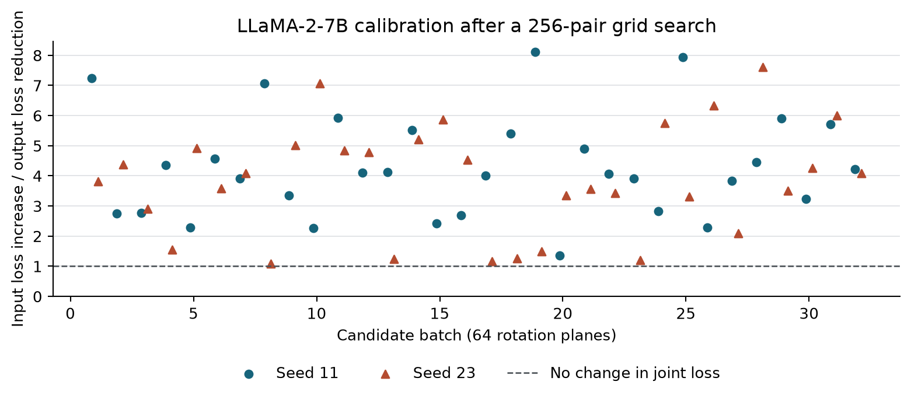

# 共享残差旋转如何改善输出投影

原 A100 实验里，CellQuant 相对 Hadamard 在六个输入侧位置的中位 NMSE 降幅为 3.3172%，在三个输出侧位置仅为 0.0228%。同一批数据上的角度网格分别为 3.1783% 和 0.0118%。128 次坐标更新在两个种子中分别触及 250 和 245 个不同的输出坐标，总维数为 4096。01b 测得，这些行只覆盖初始输出残差能量的 6.11% 和 6.02%。这意味着，即使稀疏旋转把选中行修得很好，其余行的输出误差仍原样保留。[A100 原始文档统计](../evidence/output_matching_20261118/historical_7b/site_effects.json) · [01b 拟合诊断](../evidence/g1_pair_diagnostic_20261118/a100_summary.json)

## 输出侧为什么能一次搜索所有行

先用联合角度网格拟合所有位置，得到共享正交矩阵 $Q_0$。在一个 `down_proj` 面板上，定义 $V=Q_0 B$，激活为 $U$，其量化反解为 `U_hat`。对不相交的行对各施加一个角度，把所有二阶 Givens 块合成矩阵 $M$，新旋转为 $Q=M Q_0$。同一组角度作用于所有层，导出的约定仍为 `R1 = Q.T`。

在对称动态 AbsMax RTN 下，每个输出行的权重量化组完整保留在行内，右侧激活不随 $M$ 改变。因而 `quant(M V) @ U_hat - M @ (V @ U)` 在行对 $e$ 上的误差仅依赖该对的角度。Frobenius 平方范数按行相加，目标能量在正交变换下守恒。各输出面板的加权 NMSE 因此也能写成各行对的一元代价之和。若只允许每对从同一个有限网格中选角，分别取最小值就给出该冻结输出子问题的网格最优值。对于 4096 维和 17 个候选角，只需评估 2048 × 17 个行对候选。实现按完整行分批，两行归约维上的通道全部参与动态尺度计算。[输出侧实现](../src/cellquant/output_matching.py)

输入侧的 `W @ Q.T` 和 `Q @ X` 同时改变，多个行对可以触及同一个量化组。实现对原分组的最大绝对值平方 $m_g^2$，逐对计算该对新成员超出它的正部。同一对两轴落在同一组时取较大的超额，落在不同组时分别累计。一个组在全部更新后的峰值增量至多等于这些非负超额之和。乘以 `group_width / (4 * qmax²)` 并按原张量平方范数归一化，就得到原物理尺度风险的增量上界。输出权重风险逐行精确相加，输出激活风险保持恒定。

每一对各分得原权重、激活两项剩余额度的等份，零角始终可选。按乘积误差选好一整组角后，程序对整组步长 0、¼、½、1 分别在全部九个拟合面板上重新量化，保留两项风险都合格且联合损失最低的解。等份分配给出保守的可行候选。每个种子保存完整候选角、上界、四次直接重算值和最终实际应用的非零角数。[联合校准与对照](../src/cellquant/matching_study.py)

## 42M 预训练模型实测

本机使用 RTX 3050 Laptop、FP32 预训练 LLaMA、FP64 面板求解器和 SpinQuant 固定图。原 checkpoint 的独立参数数为 41,689,600，Norm 融合将共享的 embedding 和输出头拆开后为 58,073,600。层 0、3、7 各取 q、up、down，同一个 R1 作用于九个位置。两种子各用八份拟合文档，起始网格 16 对，延长后 32 对，每对 129 个角。全覆盖阶段考察 256 个不相交行对、每对 17 个角。原模型的 K/V 组宽按 head dimension 取 64，7B 协议为 128。[固定模型](https://huggingface.co/Xenova/llama2.c-stories42M/tree/be9e05cce52ef2a4615026726bddb12639d541f5) · [固定 WikiText 版本](https://huggingface.co/datasets/Salesforce/wikitext/tree/b08601e04326c79dfdd32d625aee71d232d685c3)

以下数字为对照 NMSE 的相对降幅，正值表示改善。各位置先对两个校准种子的相对改善取均值，再对指定位置取中位数。括号为固定已训练旋转和位置后，按整份验证文档配对重采样 10,000 次的 95% 百分位区间。相同文档在所有方法和位置使用相同抽样权重，跨种子重复的文档也只抽一次。

| 验证文档与比较 | 三个输出位置 | 六个输入位置 | 全部九个位置 |
|---|---:|---:|---:|
| 第一批 16 篇，网格 16 对 + 输出修正，相对网格 16 对 | +1.84% [1.39, 2.26] | −0.51% [−1.08, 0.98] | +1.02% [0.39, 1.48] |
| 同一批，相对继续跑到 32 对的网格 | +1.59% [1.10, 2.11] | −2.77% [−3.50, −1.90] | −1.88% [−3.00, −0.39] |
| 第二批 8 篇，网格 16 对 + 输出修正，相对网格 16 对 | +1.70% [1.18, 2.11] | +0.10% [−0.55, 1.07] | +0.97% [0.23, 1.45] |
| 第二批 8 篇，网格 32 对 + 输出修正，相对网格 32 对 | **+1.16% [0.87, 1.43]** | −0.65% [−1.38, 0.09] | **+0.71% [−0.46, 1.07]** |

第一批的两个种子各有八篇不同的验证文章。看完第一批结果后固定“延长网格再追加一次输出修正”，用第二批八篇此前未使用的文章检验，两个种子共享这八篇。三轮小模型运行共用相同的拟合文档，第二批检验文档迁移，校准种子仍为两个。上述比较都衡量真实预训练层的 RTN 乘积误差。[第一批逐位置结果](../evidence/output_matching_20261118/pretrained_42m/site_effects.json) · [第二批逐位置结果](../evidence/output_matching_20261118/hybrid_42m/site_effects.json) · [复核记录](../evidence/output_matching_20261118/validation.json)

### 哪些变化产生了收益

- **能覆盖多少行。** 第一批中，全覆盖相对同一匹配表前 16 对的输出改善为 +1.58% [1.17, 1.97]。完整 256 对都是候选，最终实际应用了 64 和 66 对非零角。
- **用什么信号选角。** 保持起点、行对、角度网格和风险规则相同，按量化后乘积选角相对仅按权重量化误差选角，输出改善为 +1.09% [0.76, 1.41]。这项消融直接检验校准激活中的方向信息。
- **为何需要提前分配风险。** 首轮拟合中，种子 11 的无约束候选把三输出损失从 0.09328 降到 0.07925，九位置联合损失也从 0.21664 降到 0.20804，但权重和激活风险都超过了原上限。第一批对照中，两个种子只在最后检查风险时均回退到起点，提前分配风险后均接受了更新。[首轮拟合记录](../evidence/output_matching_20261118/fit_diagnosis.json)
- **误差究竟减在哪里。** 每份文档保存 `E_W = (W_hat - W) @ X_hat`、`E_A = W @ (X_hat - X)` 两项能量及其带符号交叉项 `2〈E_W,E_A〉`。三项之和还原实际误差。输出侧 $E_A$ 只经正交左乘，能量恒定。第一批种子 11 的第 7 层 down 误差下降 4.370%，其中权重误差经激活传播的变化贡献 4.164 个百分点，交叉项贡献 0.205 个百分点。这个分解能逐文档复算。[第一批原始测量](../evidence/output_matching_20261118/pretrained_42m/measurements.zip)
- **从强网格再出发会怎样。** 第二批中，种子 11 追加了 68 个非零角，三个输出位置的中位改善为 2.31%。种子 23 的完整步虽把输出拟合损失从 0.09603 降为 0.09243，九位置联合损失却从 0.21019 升为 0.21035，于是保留了原网格，收益为零。两种子追加阶段分别实测 0.625 和 0.609 秒。耗时包含同步与拟合复核，设备为本机 RTX 3050。不同搜索的候选角数、可训练角数和墙钟成本分别报告。[第二批原始测量](../evidence/output_matching_20261118/hybrid_42m/measurements.zip)
- **同一协议重跑能否复现。** 结束其他 GPU 测试后，按相同协议重新校准并验证第二批，16 份方法记录的 Q 哈希和逐块验证字段全部复现。延长网格两种子校准分别为 73.33 和 72.29 秒，追加修正分别用时 0.61 和 0.58 秒。该次重复使用相同的八篇验证文章。[重跑计时与逐方法哈希](../evidence/output_matching_20261118/hybrid_42m/timing_repeat.json)

## 01d 的 A100 运行协议

在已经完成原 G1 输入准备的 Colab 终端执行下行。父输入默认为 `runs/prepared/g1_gpu/config.json`，若已迁到其他位置，可通过 `--config 路径` 指定已恢复的配置。新 Python 进程读取刚 pull 的代码。也可以使用 01d 的 `RUN_MATCHING_STUDY` 开关运行同一入口。

```bash
cd /content/CellQuant && git pull --ff-only && python scripts/run_output_matching.py
```

脚本保留原八份拟合文档与模型、量化配置，对每个种子从 WikiText **train** 另选八份验证文档。新验证集排除原 G1 的拟合及验证文档，也排除为 01c 条件复验预留的文档。A100 上依次评估 Hadamard、128 对网格、延长至 256 对的网格、128 对匹配前缀、全覆盖仅权重选角、全覆盖只做末端风险检查、全覆盖乘积选角、延长网格加全覆盖乘积选角。全覆盖候选为 2048 对。每个运行都有独立目录和心跳，终端打印结果包 `runs/01_pilot/matching_*/output_matching.zip`。[终端入口](../scripts/run_output_matching.py) · [可选 01d notebook](../notebooks/01d_Colab_Output_Matching.ipynb)

本机另用完整 4096 × 11008 输出权重、64 × 4096 输入权重和八个合成 token 实测一次修正。RTX 3050 完成 2048 对 × 17 角和全部联合复核用时 19.22 秒，峰值分配 2.57 GiB。直接重算与行对加和预言的输出损失增量相差 2.1 × 10⁻¹⁷。这项工程检查覆盖完整归约维和行对规模。A100 的九个真实面板另行计时。[CUDA 原始记录](../evidence/output_matching_20261118/cuda_4096.json)

**7B 的预定读法。** 主比较为 `primary_vs_warm_grid.output`。两个种子方向均正、文档配对区间下限大于零，支持输出侧机制在 7B 上复现。结合 `activation_information.output` 和 `coverage.output` 解读信号与覆盖各自的贡献。第二个问题看 `hybrid_vs_continued_grid` 的九位置中位数、输入侧代价、两种子符号和新增校准时间。若九位置区间下限也为正且两种子均改善，下一步是冻结组合方法，在新文档上做包含原五种方法及延长网格的正式 G1。仅输出侧复现则优先完成机制与输入代价的论文实验，保留完整模型矩阵的经费。正式 G1、模型级 G2 及项目原定门槛仍各自评估。

论文的核心问题是，在有限校准预算下，一个共享旋转对输入和输出投影为何产生不同收益。输出侧可分离性带来一个可用独立数据验证的解法，以低附加校准成本修正传播到输出的量化误差。下一层证据是跨模型、至少三个校准种子的重复，以及同设置 SpinQuant、近期可复现强方法和 GPTQ 后的 PPL 与下游结果。按目前数据，最充分的证据集中在输出位置和误差来源。

## 7B 实测与下一轮决策

2026-11-19，LLaMA-2-7B 在 A100-SXM4-40GB 上完成 01d，程序用时 12 分 39 秒。两次校准分别使用八篇拟合文章，验证共用到另外 16 篇 WikiText train 文章。已核验 16 份方法记录的 SHA-256，从 1152 条逐文档、逐位置测量复算了七组对照。下表给出 NMSE 相对降幅，正值表示改善。先在各位置平均两个种子的相对降幅，再在指定位置取中位数。方括号是固定这两个拟合结果、按文档配对重采样 10000 次的 95% 区间。[实测图](../evidence/output_matching_20261119/colab_7b_effects.png) · [原始测量](../evidence/output_matching_20261119/measurements.zip)

| 候选与参照 | 三个输出位置 | 六个输入位置 | 全部九个位置 |
|---|---:|---:|---:|
| 128 对网格加修正，相对 128 对网格 | +1.55% [1.47, 1.63] | +0.59% [−0.89, 1.54] | +1.33% [0.85, 1.59] |
| 128 对网格加修正，相对 256 对网格 | +1.56% [1.48, 1.64] | −1.04% [−2.50, −0.45] | −0.28% [−1.51, 1.00] |
| 256 对网格加修正，相对 256 对网格 | 0% [0, 0] | 0% [0, 0] | 0% [0, 0] |

128 对网格后，种子 11 接受了 1506 对旋转，三个输出的中位改善为 3.10%。种子 23 提出了 1443 个非零角，最后保留原网格。种子 11 的第 31 层 `down_proj` 在独立文档上改善 5.68%，其中 5.51 个百分点来自经激活传播的权重量化误差。第 0 层 `up_proj` 的误差同时增加 24.91%，其中 23.81 个百分点也来自这一项。两个种子上的匹配前缀、仅权重选角和只做末端风险检查对照都返回了各自的 128 对网格，因此这三个消融观察到同一差值。相对 256 对网格，早期加修正的两个种子合计在三个输出位置都改善，在六个输入位置都退化，第 0 层 `up_proj` 的平均相对退化为 17.67%。[逐种子归因与试探记录](../evidence/output_matching_20261119/colab_7b_summary.json)

256 对网格之后，两个种子的整批修正分别提议 1548 和 1437 个非零角。0.25、0.5 和 1 三个步长在两次拟合中全部通过权重和激活尺度预算。下表是步长 1 在拟合数据上的绝对损失变化，各位置使用原目标权重。每次试探都降低了输出损失，但联合目标上升。最终两个种子都接受 0 对，各自的 Q 哈希与 256 对网格相同，额外校准分别用时 1.56 秒及 1.55 秒。

| 校准种子 | 三个输出的损失变化 | 六个输入的损失变化 | 九位置联合变化 |
|---|---:|---:|---:|
| 11 | −0.007733 | +0.017082 | +0.009349 |
| 23 | −0.006939 | +0.015199 | +0.008260 |

按上文的预定读法，主比较的两种子一致性和强网格后的增量条件都未达到。正式 G1 保留 11 月 18 日的 FAIL。下一轮只检验在选择输出行对时纳入真实输入代价，是否能留下对双方有用的更新。

### 在 Colab 运行分批拟合短测

保留上次准备好的 `runs/prepared/g1_gpu/config.json`。推送本轮代码后，在 Colab 终端执行下行。它从归档因子重建 256 对网格，重新采集八篇拟合文档，核对面板和 Q 哈希并复算原整批试探。每个种子将原顺序的 2048 对分为 32 批，每批 64 对，仅试原步长 1。每批在当前共享 Q 上实测九位置损失与原尺度预算，满足预算且联合损失下降才采纳。另记录固定随机数种子下选取同样批数的参照，以及各位置的拟合 NMSE。该诊断只使用拟合误差做选择。[短测实现](../src/cellquant/matching_batches.py)

```bash
cd /content/CellQuant && git pull --ff-only && PYTHONPATH=src python -m cellquant.experiment --config runs/prepared/g1_gpu/config.json --screen-matching-batches evidence/output_matching_20261119/measurements.zip
```

本机先用预训练 42M 的原拟合文档和已冻结的 32 对网格回放了同一程序。种子 11 和 23 各保留了四批中的两批，分别应用 33 和 34 个非零角，九位置拟合损失相对原整批最佳步下降 0.53% 和 0.83%。两个种子的输出拟合损失也下降。这个结果用于安排 7B 短测，独立验证文档留给下一步。[42M 逐批拟合记录](../evidence/output_matching_20261119/fit_batches_42m.json)

终端打印 `run_dir` 和 `next_step`，每个种子另写 `batch_fit.json`。若两个种子的联合拟合损失都低于原整批最佳步，且输出拟合损失都低于 256 对网格，则返回 `fresh_document_pilot`。随后冻结这一版，在排除已读验证文章的新文档上与相同 256 对网格配对比较，并报告同批数随机参照、最差位置和校准总时间。沿用 01d 的投入原则，在新文档上九位置区间下限为正且两种子均改善时，进入含完整匹配对照的正式 G1。若短测返回 `stop_batch_variant`，本轮分批方案到此结束。服务器全量实验仍按 G1 之后的受限 canary 和后续 G2/G3 执行。

### 分批旋转的独立文档验证

2026-11-19 的 7B A100 拟合短测用时 72 秒，返回 `fresh_document_pilot`。按程序，两种子的九位置拟合损失均低于整批最佳步，三个输出位置的损失均低于 256 对网格。保存的终端片段给出了种子 23 的明细。它保留 1/32 批、46 个非零角。九位置拟合损失之和下降 0.000004037，输出项下降 0.000211507，六个输入位置合计增加 0.000207470，抵消约 98.1% 的输出收益。百分比的分母分别取原网格的九位置损失 0.1839143 和输出损失 0.0940084。两个种子的原始逐批记录由下次运行从原 Colab 抄入结果包。[终端记录](../evidence/output_matching_20261119/fit_batches_7b_terminal.json) · [01d 网格测量](../evidence/output_matching_20261119/measurements.zip)

在保留原拟合结果的 Colab 终端执行以下命令。

```bash
cd /content/CellQuant && git pull --ff-only && python scripts/run_output_matching.py --validate-batches
```

- **冻结旋转。** 程序按原 G1 配置和 01d 归档的 SHA-256 寻找最近一次匹配的拟合运行，核对两个种子的逐批文件、所选批次和重建 Q 的指纹。每个种子回放三种方法，包括原 256 对网格、其上追加已接受批次，以及其上追加拟合时已抽定的同批数随机对照。随机批的非零角数可能不同。
- **验证数据。** 使用原 WikiText-2 train 修订，排除两种子的原拟合及验证文档、01c 预留文章和 01d 实际评分文档。两个种子各抽 16 篇，互不重叠。按文档 ID、全文哈希及 token 块哈希复核。每篇在 2048-token 上下文中取 32 个位置，每个种子的三种方法共用同一面板。
- **主指标。** 各位置用逐文档平方误差之和除以目标能量之和。对每个种子计算相对网格的 NMSE 降幅，在每个位置平均两个种子的降幅，再取九位置中位数。共做 10000 次按种子分层、在文档层配对的 bootstrap，区间以这两个拟合结果为条件。同时报告每种子的九位置中位数、输入与输出子组、最差位置和同批数随机对照。校准成本按原网格、原候选生成及分批复核的实测耗时相加，含拟合时回放和随机对照的开销。
- **决策。** 仅当两个种子的九位置中位降幅分别大于零，且主指标 95% 区间下限大于零，返回 `formal_g1_retest`，随后安排新方法和完整匹配对照的正式 G1 复验。其余可计算的结果返回 `stop_batch_variant`。若分母为零导致主比较无法计算，返回 `insufficient_evidence`。保留原 G1 判定以及后续 canary、G2 和 G3 的门槛。

终端最后一行给出 `runs/01_pilot/batch_documents_<id>/batch_document_pilot.zip`，其中包含准备协议、文档与 token 哈希、原拟合记录、六份逐文档测量和汇总。若拟合目录已从 Drive 恢复到其他位置，在同一命令末尾加 `--screen-run /实际路径`。目录里应有 `result.json` 和两个 `seed_*/batch_fit.json`。原 G1 输入可通过 `--config` 指定。若实例已经释放且拟合目录没有备份，先使用上节的短测命令在原 G1 输入上重建分批选择。

本机 42M 在 RTX 3050 上回放了自己已拟合的旋转，使用 32 篇未参与此前 42M 实验的 train 文章。对其 32 对父网格，九位置中位 NMSE 改善 1.554%，配对 95% 区间为 [0.856%, 1.633%]。两个种子各改善 0.705% 和 1.007%，最差位置为第 0 层 up_proj，平均退化 2.445%。42M 的 256-token 上下文及网格预算均与 7B 有别。这个测量验证了回放、独立文档评分和区间计算流程。[42M 原始逐文档测量](../evidence/output_matching_20261119/batch_documents_42m.zip)

### 7B 独立文档结果与正式复验

2026-11-19，LLaMA-2-7B 在 A100-SXM4-40GB 完成评分。两个种子各用 16 篇未用过的 WikiText train 文章。六份测量、旋转及面板指纹、token 缓存和文档排除清单均已核对。逐块汇总 NMSE 并按种子分层重采样文档 10000 次，复现以下结果。数值为相对误差降幅，正值代表改善，区间以这两个已拟合旋转为条件。[完整测量包](../evidence/output_matching_20261119/batch_documents_7b.zip) · [统计与归因数据](../evidence/output_matching_20261119/batch_documents_7b_summary.json)

| 比较 | 九位置中位降幅 | 配对 95% 区间 | 种子 11 | 种子 23 |
|---|---:|---:|---:|---:|
| 拟合选批对 256 对网格 | +0.0812% | [+0.0378%, +0.1329%] | +0.0749% | +0.0875% |
| 同批数随机对 256 对网格 | +0.0177% | [−0.2352%, +0.1259%] | +0.0921% | −0.0668% |
| 拟合选批对同批数随机 | −0.0072% | [−0.0726%, +0.0620%] | −0.0171% | −0.0004% |

相对网格，六个位置的跨种子平均 NMSE 下降。三个 down_proj 在两个种子上都下降，跨种子平均的改善分别为 0.056%、0.081%、0.153%。第 0 层 q_proj 和 up_proj 在两个种子上都退化，跨种子平均分别为 1.846%、0.992%。q_proj 的激活误差和权重–激活交叉项分别贡献 −1.079、−0.973 个百分点，权重项贡献 +0.206 个百分点。若在独立文档上按拟合时的绝对目标相加，九位置 NMSE 之和在种子 11 上升 0.0338%，在种子 23 下降 0.0184%。这些量回答的分别是典型位置和总重建损失的问题。

两个种子都只保留 32 批中的 1 批。已选批次分别有 49、46 个非零角，固定随机批次分别有 51、50 个。相对网格，拟合选择的增量校准成本为 5.73、5.65 秒，均含候选生成、拟合回放和随机对照开销。当前数据支持共享旋转带来的小幅输出改善。拟合选批的额外贡献与下游 PPL、GPTQ 效果仍待验证。

#### 在 Colab 复验

```bash
cd /content/CellQuant && git pull --ff-only && python scripts/run_output_matching.py --retest-batches
```

程序验证上述结果包和原 G1 输入后，从同一固定修订排除已见数据，种子 11 和 23 各另取 8 篇拟合和 16 篇验证文章。48 篇文章在 ID、内容哈希和 token 块哈希上互不重叠。原 9 个位置、2048-token 上下文、量化方式、R2/R3/R4、128+128 对网格和 64 对一批的选择规则均沿用。每个种子的旋转和网格在新拟合文档上从头学习。

先在新验证面板评分 Hadamard、256 对网格、分批候选及固定同批数随机对照。完整比较把父网格列入对照。逐位置最强对照的 NMSE 至多等于父网格，因此相对最强对照的中位改善至多等于相对父网格的改善。最快对照的校准时间也至多等于父网格时间。程序用这两个上界检查现有 G1 准确率路线要求的 5% 和效率路线要求的 2×。在本轮已读的 32 篇文章上，这两个上界分别是 0.0812% 和 0.9833×。正式复验只用新文档和新计时来判断。

- 如果新的上界已同时排除两条路线，默认返回 `RETEST_STOPPED_BY_BOUND`，保存 `route_bounds.json` 和逐文档测量。此时完整对照尚未执行，保留原正式 G1 记录。
- 若仍有路线可达，继续同目标的角度网格、STE 和固定尺度搜索。三者共用新拟合的父网格、同一组 2048 个平面、角度范围、风险上限及每方法完整校准预算。网格和 STE 各给每平面 17 次候选评估，固定尺度使用原数值搜索。正式比较对每个种子和位置取父网格及三种匹配求解器中最低的 NMSE。资源中断保留部分记录，不能晋级。
- 希望无论上界都测量三个求解器时，在同一命令后加 `--all-controls`。完整比较后使用 `configs/gate_rules.json` 生成 `G1.json`，另从逐文档输出计算相对逐位置最强对照的配对区间。结果包名为 `batch_g1_retest.zip`，稠密 Q 保存在 Colab 的运行目录里。正式 G1 PASS 后，下一阶段是检验同一分批方法的单模型 GPTQ canary。

### 7B 复验结果

A100 运行 `2026-11-19T085120.278159_0000_5393b46d7a` 用时 14 分 43 秒。两个种子各用 8 篇新文章从头拟合，另用 16 篇评分。按文档 ID、内容与 token 哈希核对了新旧样本的隔离，8 份方法记录的逐块 NMSE 和 10000 次配对文档抽样均能复算。两个种子最终应用的角度数均为零，256 对网格、分批选角和同批数随机对照的 Q 文件哈希在各自种子内相同。九位置中位改善和文档区间均为 0% [0%, 0%]。这个区间描述固定旋转后同一文档上的相同输出。早期 pilot 的 +0.0812% 仅验证了当时拟合的两个旋转。[原始复验包](../evidence/output_matching_20261119/batch_g1_retest_7b.zip) · [独立复算](../evidence/output_matching_20261119/batch_g1_retest_7b_summary.json)

| 7B 分批追加修正 | 种子 11 | 种子 23 |
|---|---:|---:|
| 提出的非零角 | 1530 | 1602 |
| 试验批数 / 满足尺度限制 / 减少联合拟合误差 | 32 / 32 / 0 | 32 / 32 / 0 |
| 每批输入损失增量与输出损失降幅之比，中位数 | 4.08 | 3.96 |
| 256 对网格校准秒数 | 394.55 | 394.69 |
| 分批方法校准秒数 | 400.23 | 400.35 |

64 批的输出侧拟合误差均下降，输入侧代价均超过这项收益。按完整步长同时试探所有候选角时，种子 11 的输出损失减少 0.007342，输入损失增加 0.018299。种子 23 分别为减少 0.007538 和增加 0.012633。最终相对 Hadamard 改善 3.3700% [1.5665%, 4.9037%]，父网格单独就取得了这一结果。



父网格属于最强对照的候选，因此准确率路线的相对收益至多为 0%，要求为 5%。最快对照的校准速度比至多为 0.9858×，要求为 2×。程序返回 `RETEST_STOPPED_BY_BOUND` 和 `stop_batch_variant`，完整匹配比较未执行。本次没有新的正式 `G1.json`。停止追加式版本，保留旧正式 G1 的 FAIL。单纯把输出修正前移到 128 对后，早先 01d 已测得相对 256 对网格中位改善 −0.28%，对应六个输入位置为 −1.04%。本次仅跑完 128 对前缀已需 198.80 和 198.12 秒，两者均超过各自完整网格耗时的一半。[G1 判据](../configs/gate_rules.json) · [此前的短网格结果](#7b-实测与下一轮决策)

### 在选角时计入输入侧误差

新诊断从 256 对网格的前 64 对出发。每个不相交平面考察原来的 17 个角。对输入面板，沿用父旋转完整分组的解码尺度，对改变的两列权重和两行激活同时重新舍入。设父旋转的量化乘积残差为 $E$，该平面两通道解码乘积的变化为 $D$。固定尺度时，单平面平方误差的变化准确等于 $2\langle E,D\rangle + \lVert D\rVert_F^2$。实现把这项估计与输出侧可精确计算的损失变化相加，用来选角。多个平面同时作用或组尺度改变时，输入损失会有额外项。每次接受一批前，对九个拟合面板重新执行完整的动态量化并检查原尺度预算。[选角实现](../src/cellquant/output_matching.py) · [短测与冻结回放](../src/cellquant/bilateral_screen.py)

本机预训练 42M 使用同样规则，从完整 32 对网格的前 8 对出发。仅按输出选角的对照使用相同的起点、候选平面、风险上限与批大小。两个种子各用八篇拟合文章，均接受 4/4 批，相对仅输出选角的联合拟合损失分别下降 2.553% 和 2.840%。冻结旋转后，在另外 32 篇 WikiText 文章上评分。抽样排除了此前的 42M 文档及本轮 7B 复验和其清单内的旧文章。42M 模型前向为 FP32，求解器为 FP64，上下文 256。以下为九位置中位相对 NMSE 降幅，以固定的两个拟合结果为条件。[拟合追踪](../evidence/output_matching_20261119/bilateral_fit_42m.zip) · [验证测量](../evidence/output_matching_20261119/bilateral_documents_42m.zip) · [统计汇总](../evidence/output_matching_20261119/bilateral_documents_42m_summary.json)

| 42M 独立验证比较 | 九位置中位数 | 文档配对 95% 区间 | 种子 11 | 种子 23 |
|---|---:|---:|---:|---:|
| 输入与输出共同选角，相对同起点仅输出选角 | +3.6570% | [+2.9300%, +4.6226%] | +0.4490% | +5.1704% |
| 相对完整 32 对网格 | +1.0445% | [+0.6099%, +1.3469%] | +0.2694% | +0.6433% |
| 相对 Hadamard | +5.9862% | [+4.7540%, +6.9698%] | +3.2812% | +5.3178% |

相对仅输出选角，六个输入的中位改善为 4.3972%，三个输出退化 0.6866%。相对完整网格，三个输出中位改善 0.8865%。短测从归档恢复网格，只测量追加校准时间。端到端校准速度须从同机从头拟合测得。

在原 G1 输入可用的 Colab A100 终端运行下行。程序重新生成本次复验的同一份文档清单，从归档因子重建完整网格和 64 对前缀，并在收集拟合面板后核对指纹及拟合损失。无需重跑 256 对角度搜索或 01 系列 notebook。

```bash
cd /content/CellQuant && git pull --ff-only && python scripts/run_output_matching.py --screen-bilateral
```

程序在拟合前固定两项短测条件。两个种子都要在九位置联合拟合损失上优于同起点仅输出选角，而且各自至少有 6/9 个位置的 NMSE 在完整网格的 2% 以内（含优于网格的位置）。符合时返回 `fresh_document_pilot`，下一步冻结新旋转并用未参与开发的文章评分。否则返回 `stop_bilateral_proposal`。两种结果都写入终端所列的 `bilateral_angle_screen.zip`。正式 G1、模型级 GPTQ 验证及 G3 准备条件分别决定后续投入。

### 7B 双侧选角的拟合与独立文档验证

A100 用时 95.57 秒完成拟合短测。两个种子各用 8 篇拟合文章。以下降幅均以对照误差为分母，正数表示改善。九位置中位数给每个位置同等权重。联合损失对九个位置的 NMSE 求和。[A100 原始追踪](../evidence/output_matching_20261119/bilateral_fit_7b.zip) · [逐种子复算及旋转哈希](../evidence/output_matching_20261119/bilateral_fit_7b_summary.json)

| 7B 拟合观测 | 种子 11 | 种子 23 |
|---|---:|---:|
| 新规则接受的批数 / 32 | 8 | 9 |
| 相对同起点仅输出选角，六个输入的 NMSE 总和降幅 | +6.81% | +6.54% |
| 相对同起点仅输出选角，三个输出的 NMSE 总和降幅 | −4.45% | −2.73% |
| 相对同起点仅输出选角，九位置联合损失降幅 | +1.56% | +2.09% |
| 相对完整网格，九位置联合损失降幅 | −2.13% | −1.53% |
| 相对完整网格，九位置中位降幅 | −0.029% | +0.409% |
| 相对完整网格，第 0 层 up 降幅 | −16.80% | −16.54% |
| 新规则 / 仅输出选角的增量耗时，秒 | 9.59 / 5.79 | 9.50 / 5.62 |

两种子均有 8/9 个位置在完整网格的 2% 以内或更好，达到预定拟合条件。第 0 层 up 在 64 对网格起点的 NMSE 已比完整网格高 21.91% 和 28.86%。双侧选角缩小了这个差距，在该位置还比同起点仅输出选角改善 4.33% 和 5.08%。新文档评估将检验这一剩余差距，以及输入侧收益能否迁移。

新验证在固定修订的 WikiText-2 train 上按种子各取 16 篇文章，每篇保留一个 2048-token 块，在同一组 32 个 token 位置评价所有旋转。抽样排除了此前两个模型的 235 篇不同训练集文章，同时检查文章内容和 token 块的 SHA-256。文章清单、比较方法和决策规则均在 7B 评分前固定。准备阶段使用固定的 7B tokenizer 重新产生并逐项核对文章与块哈希。脚本从归档恢复每个种子的 Hadamard、完整 256 对网格及同一 64 对起点的两种选角结果，检查最后的旋转哈希，并在相同九位置面板上评分。[新文档及排除清单](../evidence/output_matching_20261119/bilateral_document_cohort_7b.json)

```bash
cd /content/CellQuant && git pull --ff-only && python scripts/run_output_matching.py --validate-bilateral
```

脚本从仓库内的拟合 ZIP 读取配置。终端末行给出 `bilateral_document_pilot.zip`。包内含八份逐文档方法结果、实际面板及旋转哈希、正交残差和决策。程序在每个种子内对整篇文章配对重采样 10,000 次，报告九位置、输入侧、输出侧以及预先指定的第 0 层 up。

- `formal_g1_retest` 表示相对仅输出选角的两个种子中位降幅和配对 95% 下界均大于零，且相对完整网格与 Hadamard 的已测质量还容许至少一条 G1 路线。下一项是用全新拟合与验证文档、完整匹配求解器和从头计时做正式 G1。
- `stop_bilateral_variant` 表示对这批冻结旋转与验证文章，现有对照已排除两条 G1 质量路线。保留误差归因，停止扩大该版本。例如任何一个位置在跨种子平均后相对网格的退化超过 10%，即可排除两条路线。
- `review_inconclusive_pilot` 表示仍有路线可达，但双侧选角相对仅输出选角的迁移证据不足。`insufficient_evidence` 表示存在无法定义的比较。两者均需复核已有记录。全量矩阵仍按正式 G1、G2 和 G3 决策。

## 7B 新文档结论与第 0 层行诊断

A100 在 LLaMA-2-7B 上回放同一轮拟合的四组旋转。种子 11、23 各有 16 篇不同的 WikiText-2 训练集文章，每篇用一个 2048-token 块中的 32 个相同位置。拟合与此前实验已使用的 235 篇文章均已排除。下表的正数表示 W4A4 面板 NMSE 下降。先在各位置平均两个种子的相对降幅，再取位置中位数。95% 区间在固定种子内配对重采样整篇文章 10,000 次。[A100 原始记录](../evidence/output_matching_20261119/bilateral_documents_7b.zip) · [复算摘要](../evidence/output_matching_20261119/bilateral_documents_7b_summary.json)

| 对照与位置 | NMSE 降幅 | 95% 区间 |
|---|---:|---:|
| Hadamard，九位置 | +2.740% | [+1.804%, +4.245%] |
| 完整 256 对网格，九位置 | +0.065% | [−0.356%, +0.411%] |
| 同一起点仅输出选角，九位置 | +0.121% | [−0.837%, +0.944%] |
| 同一起点仅输出选角，六个输入位置 | +1.613% | [+0.602%, +2.281%] |
| 同一起点仅输出选角，三个输出位置 | −1.070% | [−1.182%, −0.955%] |
| 完整 256 对网格，预先指定的第 0 层 up | −13.892% | [−15.789%, −12.098%] |

相对完整网格，6/9 个位置改善，8/9 个在 2% 非劣界内。九位置中位数在两个种子上分别为 −0.554% 和 +0.525%。第 0 层 up 在两个种子都退化，32/32 篇文章上候选的平方误差均比网格高。相对网格 NMSE，权重误差项在两个种子分别增加 15.59 和 13.75 个百分点，激活项分别抵消 0.64 和 0.96 个百分点，其余由交叉项解释。这里权重项等于量化权重误差乘以量化后的激活。该定义允许逐块闭合总误差。此版本触发按协议预定的停止条件，端到端质量及速度仍待验证。

采集代码始终等距抽取同一组 64 个 up 输出行。下一步使用上述 32 篇已见文章、相同 token 和冻结 R1，以区分行覆盖偏差、短网格起点的代价以及双侧选角自身的影响。输出保留原采样 64 行、其余 10,944 行、全部 11,008 行的逐文档平方误差和目标能量。每次沿输出行分块，保留完整 4096 维归约轴。W4A4、W4Afp（只量化权重）及 WfpA4（只量化激活）共用同一 FP 目标，按平方和汇总。程序逐篇核对原 64 行的 W4A4 与上一轮一致，并比较完整网格、64 对前缀和前缀加双侧选角。该结果用于机制诊断，原文档 pilot 的判定继续有效。

```bash
cd /content/CellQuant && git pull --ff-only && python scripts/run_output_matching.py --diagnose-bilateral-rows
```

终端末行给出 `bilateral_row_diagnostic.zip` 路径。先读 `row_comparisons.candidate_vs_full_grid.complement`。若退化集中在原采样行，优先检验网格的行选择效应，另取校准行拟合、留出其他行和新文章验证。若其余行也退化，用 `prefix_vs_full_grid` 与 `candidate_vs_prefix` 区分起点损失和提案损失，再看 W4Afp 与 WfpA4。若损失集中于权重端，可以在新拟合文档和独立行块上检验动态权重量化误差约束。只有后续冻结的新候选重新通过正式 G1，才进入单模型 canary。

## 7B 第 0 层 up 全行实测

A100 用时 74.98 秒回放三个冻结旋转。第 0 层 up 的原 64 行只占 11,008 个输出行的 0.58%。核对了两个种子的旋转、面板、文档与 token 哈希，逐篇重现了上一轮原 64 行的误差。每个种子在同一批 16 篇文章上分别汇总误差能量与目标能量，再平均两个种子的相对 NMSE 降幅。正数表示前一种方法误差更小。方括号为固定两种子、按文章配对的 95% 区间。[A100 原包](../evidence/output_matching_20261119/bilateral_rows_7b.zip) · [27 组区间与种子明细](../evidence/output_matching_20261119/bilateral_rows_7b_summary.json) · [分组及单侧量化图](../evidence/output_matching_20261119/bilateral_rows_7b.png)

| W4A4 对照 | 原 64 行 | 其余 10,944 行 | 全部 11,008 行 |
|---|---:|---:|---:|
| 双侧选角 vs 完整 256 对网格 | −13.892% [−15.789, −12.098] | −0.209% [−0.463, +0.034] | −0.267% [−0.521, −0.022] |
| 64 对网格前缀 vs 完整网格 | −13.496% [−14.549, −12.441] | +0.077% [−0.073, +0.230] | +0.020% [−0.130, +0.173] |
| 双侧选角 vs 同一 64 对前缀 | −0.421% [−2.198, +1.374] | −0.288% [−0.488, −0.084] | −0.288% [−0.489, −0.083] |

就双侧选角相对完整网格而言，其余行的降幅比原 64 行高 13.68 个百分点 [11.95, 15.51]。短前缀与完整网格之间已经有 13.57 个百分点的行组差异 [12.56, 14.58]。双侧选角在原 64 行上逐篇落后完整网格，在其余行上有 17/32 篇落后，整投影有 19/32 篇落后。只量化权重时，双侧选角相对完整网格在原 64 行的误差高 39.31%，整投影高 0.656% [0.598, 0.714]。只量化激活时，整投影降幅为 +0.223% [−0.376, +0.796]。两种单侧量化各自使用浮点的另一侧，共同量化还包含两侧的相互作用。

延长角度网格的收益集中在其反复优化的行上。观测只覆盖一个权重矩阵和上一轮同一批文章。原行可能本身就容易受网格长度影响，下面的换行实验直接检验拟合行的作用。

## 交换拟合行的配对实验

把原来的 64 行记作 A。将输出行等分为 64 段，从每段预先随机抽一行组成 B，排除所有 A 行，两个种子使用相同的 B。回放原 A 网格，只把第 0 层 up 拟合面板替换为 B，重新求一个全模型共享的 B 网格。其余八个拟合面板、拟合文章、初始旋转、角度序列和预算规则相同。两套尺度上限各自从同一初始旋转下的对应拟合面板计算，归档保存各自数值。7B 每套网格共 256 对，每对 129 个候选角。分别评估 A、B、均未参与拟合的 10,880 行及全部 11,008 行，同时回放各自 64 对前缀，记录其余八个位置的变化。直接比较质量，A 网格的耗时应取原拟合记录。[换行实现](../src/cellquant/row_crossfit.py)

先在预训练 42M 上以 32 对网格、8 对前缀、每组 64 行运行了三次。归档来自干净提交 `9d0c85c`，两个种子的四组旋转及逐文档误差在三次运行中一致。相对 A 拟合的网格，B 网格在 A 行误差高 5.115%，在 B 行低 4.513%。相减得到 +9.628 个百分点 [8.789, 10.503]，两个种子分别为 +11.746 和 +7.510。其余 1,248 行改善 +0.583% [0.292, 0.877]。整投影改善 +0.518% [0.242, 0.802]，种子 11 改善 1.033%，种子 23 改善 0.003%。其余八个位置的中位改善为 +0.072% [−0.207, +0.134]。这一实验测量网格对拟合行的依赖。[42M 逐篇结果、拟合追踪与环境](../evidence/output_matching_20261119/row_crossfit_42m.zip)

7B 已另选 32 篇 WikiText-2 训练集文章，每个种子 16 篇，并排除了此前使用过的 267 篇。42M 的换行实验另用一批文章，与这 32 篇也互斥。在现有 Colab A100 仓库中执行下行，终端末尾给出 `row_crossfit.zip`。[7B 冻结文档与指标](../evidence/output_matching_20261119/row_crossfit_cohort_7b.json)

```bash
cd /content/CellQuant && git pull --ff-only && python scripts/run_output_matching.py --crossfit-rows
```

主指标为 B 网格相对 A 网格在 B 行的误差降幅减去在 A 行的降幅，单位为百分点。同一文章的抽样次数在两种方法和两组行之间共用。两个种子都须各自在自己的拟合行上获胜，且主指标的文档配对 95% 区间下限大于零，才认为拟合行效应在 7B 复现。复现后可在同校准成本下检验分批更换拟合行的策略，主看未见行、整投影和其他层的迁移。若无反转，保留本轮特定 64 行与完整投影的实测差异，停止推广拟合行效应。新算法仍按原 G1 决定是否进入整模型 canary。

## 7B 换行复验结果

LLaMA-2-7B 在 A100 上用 782.17 秒完成两种子验证。输入为事先冻结的 32 篇新文章，每种子 16 篇，每篇 32 个位置。每个网格只有一个全模型共享旋转，两次拟合只在第 0 层 up 替换了 64 个输出行，尺度上限均按各自面板的 Hadamard 起点计算。下表正数表示 B 网格相对 A 网格的 W4A4 NMSE 下降。在每个种子内重采样整篇文章，同一个抽样同时用于所有方法与行组。区间以本次的种子和行集为条件。[A100 原始记录](../evidence/output_matching_20261119/row_crossfit_7b.zip) · [逐篇复算与权重端、激活端对照](../evidence/output_matching_20261119/row_crossfit_7b_summary.json)

| 第 0 层 up 的评估范围 | 种子 11 | 种子 23 | 两种子平均与配对 95% 区间 |
|---|---:|---:|---:|
| A 的 64 行 | −34.807% | −30.740% | −32.774% [−34.476%, −31.159%] |
| B 的 64 行 | +32.021% | +24.542% | +28.281% [+27.365%, +29.169%] |
| 其余 10,880 行 | +0.313% | −0.657% | −0.172% [−0.383%, +0.042%] |
| 全部 11,008 行 | +0.360% | −0.639% | −0.140% [−0.350%, +0.072%] |

**预先指定的反转效应为 +61.055 个百分点 [58.828, 63.358]。** 两种子分别为 +66.827、+55.282 个百分点，每篇文章上均是 A 网格赢 A 行、B 网格赢 B 行。只量化权重时反转为 +138.252 个百分点 [132.218, 144.342]，只量化激活时为 −0.212 个百分点 [−1.362, +0.934]。相对降幅使用 A 网格在对应行组上的误差作分母，因此反转可以超过 100 个百分点。三种精度下的相对变化不能相加。[拟合行和未见行的对照图](../evidence/output_matching_20261119/row_crossfit_transfer.png)

把每个网格从 64 对延长到 256 对，A 网格在 A 行进一步改善 12.66%，B 网格在 B 行进一步改善 14.15%。在未参与两次拟合的行上，两次延长分别为 +0.089% [−0.111%, +0.261%] 和 −0.070% [−0.241%, +0.114%]。在其余八个位置，B 完整网格相对 A 的中位改善为 −0.0418% [−0.3398%, −0.0004%]。这给出了校准加深时误差下降发生在哪里的直接测量。此次端点是单个投影的重构，正式 G1 仍为 FAIL，GPTQ 后的 PPL 和下游任务效果尚无实测。

## 固定预算下中途更换拟合行

下一轮从归档的 A、B 网格各自的 128 对中点继续。每个种子在余下的 128 对中，分别用 B 行继续 A 网格、用 A 行继续 B 网格。固定对照 A→A 和 B→B 回放原完整旋转。四个方法各有相同的 256 对和每对 129 个候选角，均拟合一个共享 Q。同时记录历史前半段成本、实测后半段成本和总预算。第二段使用目标行面板在原 Hadamard 起点的尺度上限，记录切换时与结束时的可行性。实验不据此次回放估计推理或校准加速比。[实现](../src/cellquant/row_refresh.py)

7B 验证另外固定了 32 篇 WikiText 文章，排除先前两种模型用过的 331 篇。每个种子每篇文章保留两种换行顺序和各自的固定对照。先求 A→B 对 A→A、B→A 对 B→B 的相对 NMSE 降幅，再对顺序与种子等权平均。主指标是未见的 10,880 行。其配对 95% 区间下限大于零、两个种子各自的平均降幅为正、整投影平均改善为正，并且各换行结果满足目标面板预算时，下一步才扩大到其他投影验证。否则保留已复现的固定行效应，结束这版单次换行策略。程序另外报告每个顺序在其余八个位置的变化。正式 G1 与整模型实验有各自的投入门槛。[新文档清单与冻结规则](../evidence/output_matching_20261119/row_refresh_cohort_7b.json)

在本机预训练 42M 上先运行了同样的两种顺序，使用 16+16 对和另一批 32 篇文章。相对各自固定对照，A→B 在未见行改善 +0.287% [0.206%, 0.375%]，B→A 为 −0.235% [−0.367%, −0.101%]。按预定方式平均仅为 +0.026% [−0.049%, +0.106%]，整投影为 +0.087% [0.009%, 0.170%]。两个种子及两种顺序最终都满足各自的预算。42M 的结果支持把顺序作为对照报告，未达到该模型的未见行收益条件。[42M 逐篇测量及拟合记录](../evidence/output_matching_20261119/row_refresh_42m.zip)

7B 的固定行反转明显大于 42M，因而安排了一次 A100 换行验证。同卡此前的完整网格每种子用时约 349–395 秒。此次只重算每个顺序的后半段。以下命令用于复现已完成的作业，终端最后给出 `row_refresh.zip`。

```bash
cd /content/CellQuant && git pull --ff-only && python scripts/run_output_matching.py --refresh-rows
```

## 7B 中途换行结果

LLaMA-2-7B 的 A100 作业耗时 762.89 秒。32 篇文章与先前 331 篇隔离，两个种子各 16 篇。四条后半段搜索均完成 128 对，开始与结束均满足对应面板的尺度约束。下表为换行相对各自固定网格的 W4A4 归一化误差降幅，正值表示改善。两种顺序的平均在同一次文档重采样中计算，区间为固定两个种子的配对 95% 区间。[原始 ZIP](../evidence/output_matching_20261119/row_refresh_7b.zip) · [逐篇结果及其余八个位置](../evidence/output_matching_20261119/row_refresh_7b_summary.json) · [结果图](../evidence/output_matching_20261119/row_refresh_transfer.png)

| 范围 | A→B 对 A→A | B→A 对 B→B | 两种顺序的平均与 95% 区间 |
|---|---:|---:|---:|
| A 的 64 行 | −9.817% | +21.053% | +5.618% [5.199%, 6.065%] |
| B 的 64 行 | +22.836% | −12.469% | +5.184% [4.770%, 5.575%] |
| 均未拟合的 10,880 行 | −0.285% | −0.175% | −0.230% [−0.308%, −0.148%] |
| 整个投影 11,008 行 | −0.187% | −0.108% | −0.148% [−0.225%, −0.066%] |

未见行上，种子 11、23 的平均降幅分别为 −0.410% 和 −0.050%。换行让第二段使用的行在每篇文章上变好，也让第一段使用的行逐篇变差。两种顺序在其余八个位置的中位降幅分别为 −0.166%、−0.103%。预定投入判定为 `retain_row_effect_stop_single_switch`，这条策略到此结束。

对原始单侧量化误差作事后分解，三项都除以同一固定对照的 W4A4 误差。A→B 在 B 行的 +22.836% 中，权重单侧误差的变化贡献 +22.949 个百分点。B→A 在 A 行的 +21.053% 中，这一项为 +20.775 个百分点。未见行的 −0.230% 可分为权重单侧 −0.165 个百分点 [−0.180, −0.150]、激活单侧 −0.051 [−0.124, +0.027] 和剩余项 −0.014 [−0.033, +0.005]。剩余项包含权重与激活量化误差的乘积及平方展开的交叉项。

单独比较这批文章上的原固定 A、B 网格，其拟合行相对降幅反转了 62.54 个百分点 [60.71, 64.15]，此前为 61.05 [58.83, 63.36]。两个网格在这批 32 篇文章上再次各自赢得自己的行。两批使用相同的两个种子、行集和旋转，这项复现衡量的是换文章后的稳定性。未见行上的固定网格差异为 −0.069% [−0.240%, +0.112%]。由此可以分开量化固定行评估效应及尝试修正它的代价。

## 跨层测量拟合行与未见行

沿原来的 A 网格轨迹回放两个已冻结的全模型共享 R1。7B 比较第 256 对与第 64 对后的旋转，42M 比较第 32 对与第 8 对后的旋转。两个种子都完整测量原面板中所有的输入侧 `q_proj` 和 `up_proj`，覆盖首、中、末三层。每个投影报告原 64 个拟合行、剩余所有行和整投影。7B 的剩余集合在 up 有 10,944 行、在 q 有 4,032 行。全量归约通道、动态尺度、固定 SpinQuant 图及各自上下文保持一致。每个种子的完整旋转必须逐篇重现最近一次归档的六个拟合行面板。首层 up 同时核对整投影。[实现](../src/cellquant/row_transfer.py)

主指标为 W4A4 下中、末两个 up 投影的“拟合行 NMSE 降幅减去剩余行 NMSE 降幅”，对两层和两个种子等权。按文章在种子内配对重采样 10,000 次，角度、行组、层和方法共用文档抽样。首层为已有发现，三个 q 和两种单侧量化为辅助结果。主指标的配对 95% 区间下限大于零且两层在两个种子上的四个差值均为正时，下一步用独立文章、不同拟合行和第三个校准种子做交叉换行复验。否则将结论限制在已复现的位置。这是针对采样评估偏差的研究，不改变正式 G1。此次回放复用上一轮 32 篇留出文章，属于回顾性跨层核查。

预训练 42M 的六个位置均已在本机 RTX 3050 上完成。中层 up 的拟合行与剩余行的 W4A4 降幅分别为 5.563% 和 0.238%，末层分别为 6.617% 和 0.012%。主指标为 **5.965 个百分点 [5.466, 6.508]**，种子 11、23 分别为 5.594、6.336，四个层与种子的差值均为正。只量化权重时相应差值为 11.655 个百分点 [10.892, 12.428]，只量化激活时为 −0.082 [−0.573, +0.404]。六个位置的逐篇误差与区间均由干净提交复现。[42M 逐篇测量与旋转哈希](../evidence/output_matching_20261119/row_transfer_42m.zip)

```bash
cd /content/CellQuant && git pull --ff-only && python scripts/run_output_matching.py --audit-row-transfer
```

末行输出 `row_transfer.zip` 的路径。7B 的六投影数值待 A100 测量。已有 A100 单投影回放耗时 75 秒，换行作业的模型加载和面板采集合计 63 秒。缓存就绪时预计这次约 2–5 分钟。

## 本地复算

以下两条训练命令分别复现第一批与第二批小模型实验。脚本检查固定公开权重、tokenizer 和数据的 SHA-256。复算已有原始结果只需解压对应 `measurements.zip`，将解压目录传给分析脚本。它会验证逐方法 SHA-256，并从逐块误差重新计算区间与归因图。

```bash
python scripts/run_small_output_matching.py
python scripts/run_small_output_matching.py --confirm-hybrid
python scripts/run_small_output_matching.py --validate-batches
python scripts/run_small_output_matching.py --smoke-retest
python scripts/run_small_output_matching.py --screen-bilateral
python scripts/run_small_output_matching.py --validate-bilateral
python scripts/run_small_output_matching.py --diagnose-bilateral-rows
python scripts/run_small_output_matching.py --crossfit-rows
python scripts/run_small_output_matching.py --refresh-rows
python scripts/run_small_output_matching.py --audit-row-transfer
python scripts/analyze_row_refresh.py --output runs/row_refresh_audit.json --replay-cuda --figure runs/row_refresh.png
python scripts/analyze_row_crossfit.py --output runs/row_crossfit_audit.json --figure runs/row_crossfit.png
python scripts/analyze_bilateral_rows.py --output runs/bilateral_rows_audit.json --figure runs/bilateral_rows.png
python scripts/analyze_bilateral_documents.py --output runs/bilateral_documents_audit.json
python scripts/analyze_batch_retest.py evidence/output_matching_20261119/batch_g1_retest_7b.zip
python scripts/analyze_bilateral_fit.py --output runs/bilateral_fit_audit.json
python scripts/analyze_rotation_sites.py --study <解压目录> --output runs/rotation_analysis
```
